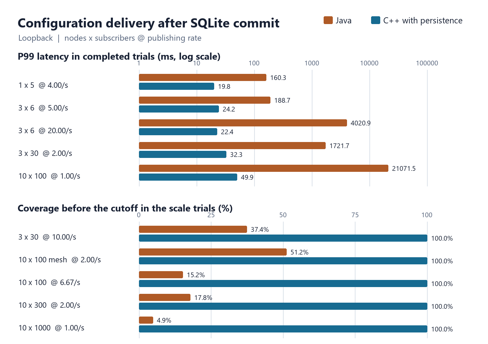

# Java 与 C++ 的配置推送测量

使用 Windows 11 26300、Core Ultra 9 275HX（24 个逻辑处理器）、约 64 GiB 内存和本机环回网络。构建组合、源码版本和二进制 SHA256 记录在每轮数据中。两边按相同节点索引放置订阅者，连续更新一个键，值为 256 字节。Java 以原生客户端的 SQLite 插入完成为终点，C++ 以协议驱动的持久游标接收和 SQLite WAL/FULL 提交完成为终点。C++ 的 live 模式也保留在每轮信息中。

稳定指全部配对在截止前收到、无运行错误、有效吞吐达到计划速率的 90%，且尾部排空至多 1 秒。下面的覆盖率分母是发布数乘订阅者数。尾延迟使用两版都收到全部配对的行，部分覆盖的原始样本可在对应目录核对。

| 节点 × 订阅者 | 速率（次/秒） | Java 完成 | C++ 持久完成 | P99（Java / C++，ms） | 有效吞吐（Java / C++，次/秒） | 原始结果 |
| --- | ---: | ---: | ---: | ---: | ---: | --- |
| 1 × 5 | 4.00 | 500/500 | 500/500 | 160.30 / 19.82 | 4.02 / 4.04 | [数据](load-2026-11-21-004519-s1u5/comparison.json) |
| 3 × 6 | 5.00 | 600/600 | 600/600 | 188.70 / 24.16 | 5.00 / 5.04 | [数据](load-2026-11-21-004705-s3u6/comparison.json) |
| 3 × 6 | 20.00 | 300/300 | 300/300 | 4020.94 / 22.41 | 7.68 / 20.23 | [数据](load-2026-11-21-004306-s3u6/comparison.json) |
| 3 × 30 | 2.00 | 1,500/1,500 | 1,500/1,500 | 1721.75 / 32.32 | 1.95 / 2.04 | [数据](load-2026-11-21-005353-s3u30/comparison.json) |
| 3 × 30 | 10.00 | 1,681/4,500 | 4,500/4,500 | — | 0.80 / 10.04 | [数据](load-2026-11-21-004841-s3u30/comparison.json) |
| 10 × 100（C++ mesh） | 2.00 | 1,793/3,500 | 3,500/3,500 | — | 0.31 / 2.05 | [数据](load-2026-11-21-010653-s10u100/comparison.json) |
| 10 × 100 | 1.00 | 2,200/2,200 | 2,200/2,200 | 21071.54 / 49.94 | 0.61 / 1.04 | [数据](load-2026-11-21-005551-s10u100/comparison.json) |
| 10 × 100 | 6.67 | 1,214/8,000 | 8,000/8,000 | — | 0.04 / 6.72 | [数据](load-2026-11-21-005021-s10u100/comparison.json) |
| 10 × 300 | 2.00 | 1,707/9,600 | 9,600/9,600 | — | 0.03 / 2.05 | [数据](load-2026-11-21-005834-s10u300/comparison.json) |
| 10 × 1000 | 1.00 | 1,070/22,000 | 22,000/22,000 | — | 0.00 / 1.03 | [数据](load-2026-11-21-010141-s10u1000/comparison.json) |

每轮目录包含运行配置、服务端 CPU 和工作集样本、原生驱动摘要及压缩的逐事件 JSONL。完整参数和稳定判定见 [runs.json](runs.json)。Java EventLoop 的线程数也已记录，原版发布确认与 C++ 持久副本确认语义不同。图中按场景绘制，两组结果使用各自的订阅实现。

复跑时使用[运行同负载对照](../load/README.md)的命令，并从对应的 `trace.json` 取 `-Servers`、`-Subscribers`、`-Warmup`、`-Ops`、`-GapMs`、`-ValueBytes`、`-DeadlineMs` 和 `-CppOverlay`。读取 `meta.json` 的 Java 日志档位和事件循环线程数，加上 `-MeasurePersist` 复做提交边界对照。
